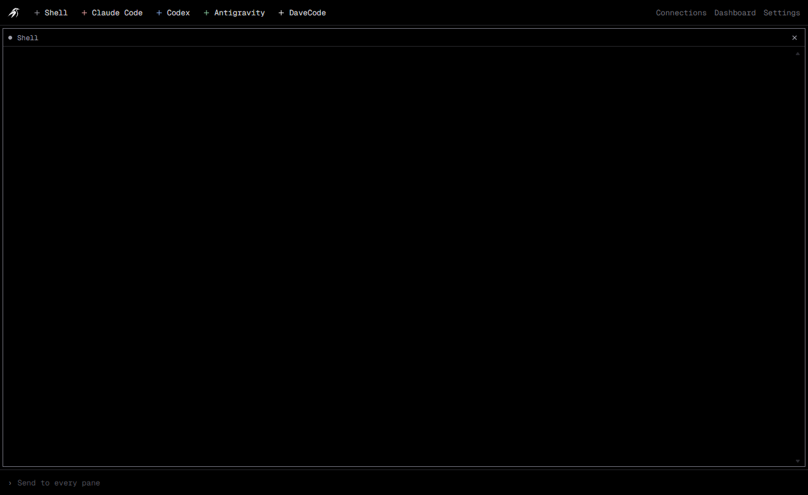
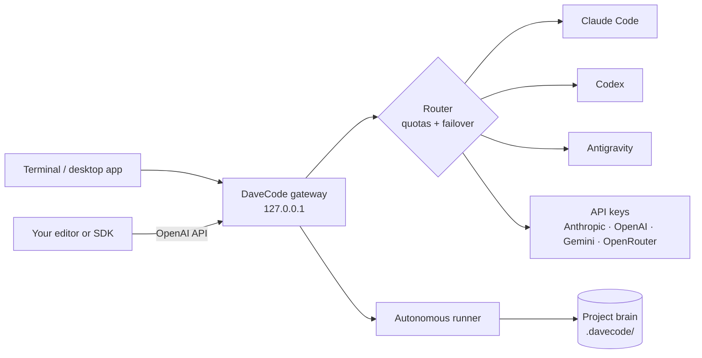

<div align="center">

<picture>
  <source media="(prefers-color-scheme: dark)" srcset="assets/brand/logo-white.svg" />
  
</picture>

# DaveCode

**Every coding agent. One terminal.**

Run Claude Code, Codex and Antigravity side by side with the subscriptions you already pay for.
DaveCode routes each task to the right agent, fails over when a quota runs out, and keeps
everything on your machine.

[Website](https://davecode.app) · [Download](https://github.com/DMRLZZ/DaveCode/releases/latest) ·
[npm](https://www.npmjs.com/package/@dmrlzz/davecode)

[](https://github.com/DMRLZZ/DaveCode/actions/workflows/ci.yml)
[](https://www.npmjs.com/package/@dmrlzz/davecode)
[](LICENSE)

</div>

## Install

**Desktop app** (Node.js included):

| Windows                                                                                                      | macOS                                                                                                            | Linux                                                                                                                        |
| :----------------------------------------------------------------------------------------------------------- | :--------------------------------------------------------------------------------------------------------------- | :--------------------------------------------------------------------------------------------------------------------------- |
| [DaveCode-Setup-x64.exe](https://github.com/DMRLZZ/DaveCode/releases/latest/download/DaveCode-Setup-x64.exe) | [DaveCode-macOS-arm64.dmg](https://github.com/DMRLZZ/DaveCode/releases/latest/download/DaveCode-macOS-arm64.dmg) | [DaveCode-Linux-x86_64.AppImage](https://github.com/DMRLZZ/DaveCode/releases/latest/download/DaveCode-Linux-x86_64.AppImage) |

The installers are not code-signed by a vendor yet: on Windows choose **More info → Run anyway**;
on macOS open the app once, then choose **Open Anyway** in **System Settings → Privacy &
Security**; on Linux `chmod +x` the AppImage.

**Terminal** (Node.js 22.12 or later):

```bash
npm install -g @dmrlzz/davecode
davecode
```

The first run shows the logo, lets you pick a dark or light look, signs you in to your DaveCode
account in the browser (Google, GitHub or email) and connects your first agent with its official
login.

The desktop app opens on real terminals: add Shell, Claude Code, Codex or Antigravity panes side
by side in your project, using the logins those CLIs already have. **Orchestrate** splits one
objective across them, each in its own git worktree, and applies the result only when you say so.
**Isolated** panes and the **Changes** panel let several agents work on one project and ship it.
New here? Read the [guide](docs/GUIDE.md).



## In the terminal

Type a question, or `/` for commands. Arrows move, Enter runs, numbers pick.

| Command                         | What it does                                                         |
| :------------------------------ | :------------------------------------------------------------------- |
| `/connect`                      | Connect Claude Code, Codex or Antigravity, or sign in to one again   |
| `/model`                        | Pick the model or route to use                                       |
| `/status`                       | The model in use and whether each agent is ready                     |
| `/route`, `/accounts`           | Routes with their failover targets; accounts with 5-hour quota usage |
| `/login`, `/logout`, `/account` | Your DaveCode account                                                |
| `/clear`, `/help`, `/exit`      | Start over, list shortcuts, quit                                     |

## Why DaveCode

- **Your subscriptions, their real login.** Claude Code, Codex and Antigravity sign in through
  their own CLIs. DaveCode never sees your passwords, and each account keeps its login in its own
  sandbox.
- **Never stall on a limit.** Sliding 1-minute, 5-hour and 24-hour windows per account, smooth
  backpressure and hot failover to the next account or agent on `429` or `5xx`.
- **One endpoint for everything else.** Point any OpenAI SDK or editor at
  `http://127.0.0.1:4040/v1` and use `davecode/auto`. Anthropic, OpenAI, Gemini and
  OpenAI-compatible API keys work too.
- **Local first.** The gateway listens on loopback; API keys are encrypted with AES-256-GCM and
  are never logged or returned.
- **Autonomous, but accountable.** Goal mode turns an objective into a task graph; code tasks run
  on their own `davecode/task-<id>` branch and merge only after your lint, typecheck and tests
  pass.

## How it works



The design is in [docs/ARCHITECTURE.md](docs/ARCHITECTURE.md), the HTTP contract in
[docs/API.md](docs/API.md) and the desktop app in [docs/DESKTOP.md](docs/DESKTOP.md).

## Agents and providers

| Agent or provider                   | Kind                            | Sign-in                             |
| :---------------------------------- | :------------------------------ | :---------------------------------- |
| Claude Code                         | `claude-cli`                    | Your Claude login, through `claude` |
| Codex                               | `codex-cli`                     | Your ChatGPT login, through `codex` |
| Antigravity                         | `antigravity-cli`               | Your Google login, through `agy`    |
| Anthropic, OpenAI, Gemini APIs      | `anthropic`, `openai`, `gemini` | API key                             |
| OpenRouter and compatible endpoints | `openai-compatible`             | Key and base URL                    |

Install the agent CLIs you want to use; `/connect` tells you how when one is missing.
Behaviour that may conflict with a provider's terms (driving a Gemini web session, rotating
several logins of one provider) is behind `experimental.*` flags that are off by default.

## Configuration

DaveCode merges built-in defaults, `~/.davecode/config.json`, `<repo>/.davecode/config.json` and
environment variables. Routes list targets in order of preference:

```json
{
  "routing": {
    "routes": [
      {
        "name": "auto",
        "targets": [
          { "provider": "claude-cli", "model": "opus" },
          { "provider": "codex-cli", "model": "default" },
          { "provider": "antigravity-cli", "model": "default" }
        ]
      }
    ]
  }
}
```

The documented schema is in [`packages/core/src/config/schema.ts`](packages/core/src/config/schema.ts).

## Build from source

```bash
git clone https://github.com/DMRLZZ/DaveCode.git
cd DaveCode
pnpm install
pnpm build
node packages/cli/bin/davecode.js
```

`pnpm lint`, `pnpm typecheck` and `pnpm test` must pass before a change is merged.

```
packages/
├── core/         contracts, storage, identity, quotas, providers, router, brain, runner
├── server/       Fastify gateway (/v1, /api, SSE)
├── cli/          the davecode command and the terminal UI
├── ui/           the workspace and dashboard (Vite, React, Tailwind)
├── desktop/      Electron app and installers
└── auth-worker/  DaveCode accounts on Cloudflare Workers and D1
site/             davecode.app
```

## Contributing

Read [CONTRIBUTING.md](CONTRIBUTING.md) and the [Code of Conduct](CODE_OF_CONDUCT.md). Report
security issues through [SECURITY.md](SECURITY.md), not public issues.

## License

[MIT](LICENSE) © DaveCode contributors
